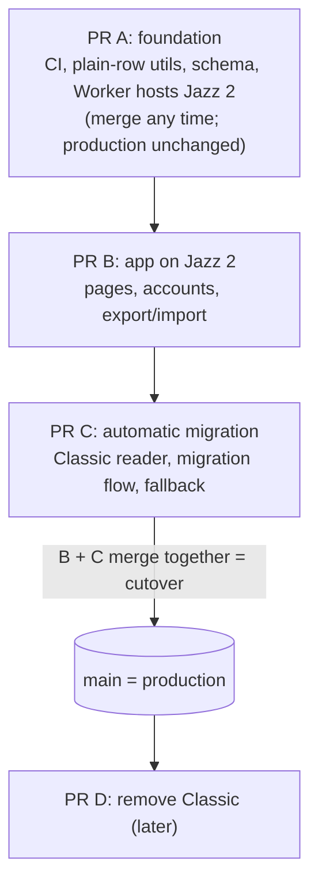
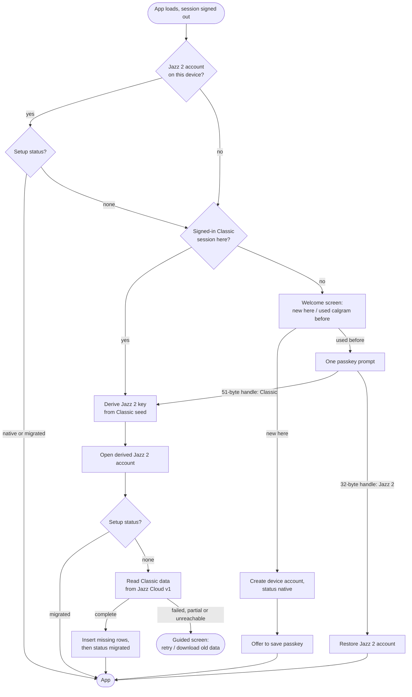

# Jazz 2 Migration - Plan

## Goal Capsule

- **Objective:** People keep using calgram at the same address, with all their meals, weigh-ins and profile intact, after Jazz Cloud v1 shuts down. They never have to do anything to make that happen.
- **Means:** Self-hosted Jazz 2 inside the `calgram` Worker (KTD1). The new build migrates each user automatically on their first visit (KTD4 to KTD7). The work lands as a stack of four PRs (KTD9).
- **Authority:** the Product Contract wins on behavior. KTDs win on mechanism. `docs/jazz2-migration.md` holds the spike evidence the KTDs cite.
- **Stop conditions:**
  - Stop and ask if a Preview build of PR A fails because of the Durable Object setup. The fallback is a separate staging Worker, not workarounds.
  - Stop and ask if any change would make production serve Jazz 2 before PR B and PR C merge together.
  - Stop and ask if any step would write to, or delete, a user's Classic data.
- **Finishing:** an implementer (ce-work or a human) opens each PR against the one below it. The owner reviews and merges.

---

## Product Contract

### Summary

calgram moves from Jazz Classic on Jazz Cloud v1 to self-hosted Jazz 2 at the same address. The new build copies each returning user's Classic data into Jazz 2 on their first visit, usually without any prompt. If automatic migration fails, a guided screen and a download of the old data are the fallback. Classic code is removed once users have moved.

### Problem Frame

Every calgram user's data lives in Jazz Cloud v1, which is being retired. When it shuts down, the app stops loading data and anyone who hasn't moved loses their history. The app has no way to contact its users, so a migration that needs them to act would strand most of them. There is no staging environment today, and every merge to `main` deploys to production.

### Requirements

**Continuity**

- R1. The app keeps working at its current address, with the same pages and behavior. Changes to look or features are out of scope.
- R2. A returning user's meals, weigh-ins, names and unit preferences appear in the new build with nothing lost or duplicated.
- R3. Timestamps keep their stored text exactly, so each entry stays on the same day it shows on today.

**Migration experience**

- R4. A returning user on a device where they're signed in to Classic is migrated silently on first visit.
- R5. A returning user on a device without a Classic session is migrated after one passkey approval, using their existing calgram passkey.
- R6. Opening the app on another device, or re-running migration, never duplicates data or creates a second account.
- R7. If automatic migration fails, the user sees a guided screen that explains what happened, offers a retry, and offers to download their old data.
- R8. A brand-new visitor can start using the app without migration prompts, and can save a passkey to recover their account elsewhere.

**Safety**

- R9. Migration only reads Classic data. It never modifies or deletes it.
- R10. Production keeps serving the Classic app until the cutover merge.
- R11. Each user's rows are private to their account.

### Key Decisions

- **Automatic migration is the primary path.** The user said manual export and import is the worst viable option, and that what matters is that users never have to know a migration happened. Governs R4, R5, R7. (session-settled: user-directed — chosen over manual export/import as the data path: users have no way to learn they must act)
- **Same address, nothing visibly changes.** Governs R1. (session-settled: user-directed — chosen over a new URL for Jazz 2: users keep visiting the site they always have)
- **Staging is per-branch Cloudflare Worker Previews.** Each Preview has its own Durable Object storage. Governs R10. (session-settled: user-directed — chosen over testing on production; Previews were switched on and verified on 2026-11-26)

### Scope Boundaries

- Contacting users who never visit before Jazz Cloud v1 shuts down. They can't be migrated, and the app has no channel to reach them.
- Making the Daily page and the Trends page agree on which day a meal belongs to, for meals logged in another time zone. That's an existing inconsistency, unchanged by this work.
- New features, UI redesign, and the unused date-of-birth field.
- Fixing `TrendAnalyzer.calculateTemporalWeightSmooth`, an existing stub that returns `[]`. Port it as it is.
- Considered and not built: closing production's `/jazz` to sign-ups between PR A and the cutover. Abuse of an unused endpoint on a small app is unlikely, and it would show up in Cloudflare usage. Revisit if usage shows unexplained storage.

### Open Questions

- **Rescue after shutdown (owner decision, not blocking).** Classic also keeps a copy of each user's data in the browser on devices they've used. A user who returns after Jazz Cloud v1 shuts down could still be migrated from that local copy, labeled as possibly incomplete. Doing so adds a fallback path to U8 and U9, and means U12 waits until it's no longer useful. As written, the plan doesn't build it.

#### Deferred to Follow-Up Work

- U12 (remove Classic) ships later as PR D, once the owner judges that users have moved or Jazz Cloud v1 has shut down.

---

## Planning Contract

### Key Technical Decisions

- KTD1. **Jazz 2 runs inside the `calgram` Worker** via `jazzWorker` from `jazz-tools/cloudflare`, on two SQLite Durable Objects (`JazzCore`, `JazzBackend`) bound as `JAZZ` and `JAZZ_BACKEND`. These class, binding and Worker names are permanent once data exists. (session-settled: user-approved — chosen over Jazz-hosted options: the user picked Workers Paid and self-hosting at the start)
- KTD2. **Pin `jazz-tools` at exactly `2.0.0-beta.5`, and install Classic as `jazz-classic@npm:jazz-tools@0.15.13`.** Classic's internal `jazz-tools/...` imports resolve back to itself through package self-reference, which the spike verified. The Cloudflare integration is marked experimental, so any version bump needs the bundle re-measured and the spike tests rerun.
- KTD3. **Drop the bundled Inspector UI from the Worker** with a Vite `resolve.alias` that maps `./inspector-ui-files.js` to a stub exporting an empty `INSPECTOR_UI_FILES`. Without it the Worker is 12.0 MB gzipped, over the 10 MB limit. With it the Worker is 6.0 MB, and it deployed and started in 98 ms on 2026-11-26.
- KTD4. **The Jazz 2 account key is derived from the user's Classic secret seed** (HKDF-SHA256 over the 32-byte seed, with a fixed calgram info string), not generated at random. One Classic identity therefore always opens the same Jazz 2 account, on every device. That makes R6 hold by construction, and the user's existing Classic passkey stays a working recovery key. Verified on 2026-11-26 with the seed of a real Classic account on Jazz Cloud v1: the derived key opens an account, and a second browser with the same seed reaches the same account and data.
- KTD5. **Every copied row gets a deterministic UUID, and migration only inserts rows that don't exist yet.**
  - The id is a UUID built from SHA-256 over a calgram namespace, the owning Jazz 2 account id, and the entry's source key. Jazz 2 requires UUID ids.
  - The source key is the Classic CoValue id when there is one. Otherwise it's a hash of the entry's content plus its position among identical entries in the file.
  - Rows are written with plain `insert` and that fixed id, never `upsert`. The server rejects an insert whose id already exists ("object already exists") or was deleted ("row already deleted"). Those rejections count as success.
  - Re-running migration or re-importing therefore never adds copies, never overwrites a newer edit, never brings back a deleted row, and never collides with another account's ids.
  - Verified on 2026-11-26 (`spikes/jazz2/tests/guards.mjs`, `classic-read.mjs`): a stale insert from an unsynced device was rejected and the newer edit survived, and an insert of a deleted id was rejected.
- KTD6. **The profile row carries a setup status: `native` or `migrated`.**
  - "Start" writes `native` when it creates a new account. Migration writes `migrated` last, after its row writes are acknowledged by the server.
  - A status present in the local copy is trusted, so the app works offline. A missing status is only acted on after a `tier: "remote"` read of the profile row confirms it's missing on the server. Offline with no local status, the app waits rather than migrating.
  - Verified on 2026-11-26: on a fresh device, a local-first read with no wait returned nothing for a row the server had, and a `tier: "remote"` read returned it.
  - A Classic read that is partial, fails to load, or can't reach Jazz Cloud v1 counts as a failure, never as an empty account.
- KTD7. **The app reads the passkey itself and routes on the length of the passkey's stored user ID (`userHandle`).** Classic passkeys hold 51 bytes (32-byte seed plus 19-byte account id). Jazz 2 backup passkeys hold 32 bytes. Both kinds share the site's hostname, so the picker can show either.
  - 51 bytes means "derive and migrate" (KTD4). 32 bytes means "restore Jazz 2 account".
  - The request asks for user verification as `preferred`, as Classic did, so Classic passkeys on security keys still work. Only 32-byte restores require verification.
- KTD13. **A Classic session counts only if it's a real sign-in.** Classic writes `jazz-logged-in-secret` for every visitor, including anonymous ones. The app treats it as a session only when it parses, has a `secretSeed`, and its `provider` is not `anonymous`.
- KTD8. **The session starts signed out (`initial: "signed-out"`), and the app decides what happens next.** Starting as an automatic device account would create a stray random account before the app knows whether the visitor is a returning user.
- KTD9. **Four stacked PRs: A, B, C, D.**
  - PR A is safe to merge on its own: it changes no user-facing behavior and only adds a dormant `/jazz` endpoint.
  - PR B and PR C are reviewed in turn but merged to `main` together. That merge is the cutover (R10).
  - PR D comes later.
  - (session-settled: user-directed — chosen over one long-lived branch, and over feature flags in production: the user asked for a stack of two to four PRs)
- KTD10. **Timestamps are stored as verbatim text.** No date type, no conversion to UTC or epoch. That keeps Daily-page day grouping unchanged (R3). Ordering uses the parsed instant at read time.
- KTD11. **Food suggestions are derived from meals at read time,** not stored in a `foodMetadata` table. Today's stored copy drifts: deletes never update it, and edits count twice. Deriving it from about 5,000 rows in memory is cheap.
- KTD12. **Utilities take plain row types.** `src/utils/*` stop importing Classic types, and export and import become pure functions (U2). The export format becomes v1.2: each entry gains an optional source `id`, so a downloaded Classic backup can be re-imported without duplicates. v1.1 files still import.

### High-Level Technical Design

How the four PRs stack and what each one ships:

What happens on a visit to the new build (R4 to R8, KTD4 to KTD8, KTD13). A missing setup status is confirmed against the server before acting on it (KTD6).

### Assumptions

- Classic keeps its session in the browser's `localStorage` under `jazz-logged-in-secret`, and Jazz 2 doesn't touch it. Jazz 2 uses its own storage names (`jazz-idb-tree*` and `jazz-auth-store-v1-*`) and only deletes its own database. Which sessions count is KTD13.

### Dependencies

- **Owner, at cutover:** merge PR B and PR C together, then run the production checks in U11.

### Risks

| Risk                                                                                | Mitigation                                                                                                                                                                                                                                                                                        |
| ----------------------------------------------------------------------------------- | ------------------------------------------------------------------------------------------------------------------------------------------------------------------------------------------------------------------------------------------------------------------------------------------------- |
| Jazz Cloud v1 shuts down before cutover, or soon after it                           | Ship the cutover as early as possible. The guided screen's "download old data" only works while v1 is up (R7).                                                                                                                                                                                    |
| Jazz 2 beta changes break the Cloudflare integration                                | Exact pin (KTD2). Rerun the spike suite and re-measure the bundle on any bump.                                                                                                                                                                                                                    |
| The setup status is written but some rows failed to sync                            | Write `migrated` only after the row writes are acknowledged by the server (KTD6).                                                                                                                                                                                                                 |
| Real users' data differs from test data, or the Classic read is slow at real volume | U10 seeds a Classic account from the owner's full export and times the silent migration on a Preview.                                                                                                                                                                                             |
| Rollback after cutover                                                              | Reverting the B+C merge restores Classic, whose data migration never touched (R9). Rows written in Jazz 2 after cutover would not carry back. Keep any rollback window short. If a second cutover follows, version the `migrated` status so it re-runs; insert-if-missing (KTD5) keeps that safe. |
| The Classic seed is the permanent root of each migrated account (KTD4)              | Accepted. It's no weaker than Classic today, where the same seed is the account.                                                                                                                                                                                                                  |

---

## Implementation Units

### U1. CI covers the whole stack

- **Goal:** every PR in the stack runs lint, format, unit tests, type check, build and E2E, not just PRs into `main`.
- **PR:** A
- **Requirements:** R10
- **Dependencies:** none
- **Files:** `.github/workflows/ci.yml`, `.github/workflows/playwright.yml`
- **Approach:**
  1. Trigger both workflows on pull requests regardless of base branch.
  2. Add `pnpm build` to CI. It runs `tsc -b` and `vite build`, so it covers type checking and bundling.
  3. Keep `runs-on: ubuntu-latest`. If a tool breaks on the runner image, upgrade the tool; never pin an older image.
- **Test expectation:** none -- workflow config. Verified by PR A's own checks running.
- **Verification:** PR A shows CI and Playwright checks, including the build step, even though it targets `main`. PR B shows the same checks while it targets PR A's branch.

### U2. Utilities take plain rows

- **Goal:** the app's logic no longer depends on Classic types, so pages can switch data layers without rewriting it.
- **PR:** A
- **Requirements:** R2, R3
- **Dependencies:** none
- **Files:**
  - `src/schema.ts` (plain `MealRow`, `WeightRow`, `ProfileRow` types next to the export shapes)
  - `src/utils/CalorieCalculator.ts`, `src/utils/TrendAnalyzer.ts`, `src/utils/FoodPredictor.ts`, `src/utils/UnitPreferenceManager.ts`
  - `src/utils/FoodIntelligenceManager.ts` (replaced by a pure derive function, KTD11)
  - `src/utils/DataExporter.ts` (pure `buildExport` from profile, meals, weights; v1.2 per KTD12)
  - `src/utils/DataImporter.ts` (pure `planImport` returning rows with source keys plus a profile patch, and applying `profile`)
  - `src/utils/rowIds.ts` (the KTD5 id function, shared by import and migration)
  - tests: `src/utils/__tests__/CalorieCalculator.test.ts`, `TrendAnalyzer.test.ts`, `UnitPreferenceManager.test.ts`, `FoodIntelligenceManager.test.ts`, `DataExporter.test.ts`, `DataImporter.test.ts`, `SchemaMigration.test.ts`
- **Approach:**
  1. Replace `Loaded<...>` parameters with the plain row types. Classic objects still satisfy them structurally, so production on Classic keeps working.
  2. Import `z` from `zod` everywhere, not from `jazz-tools`.
  3. The derived food suggestions keep today's visible behavior: 12 recents, latest calories-per-gram and category for each food name.
  4. Delete `src/components/UserProfileDialog.tsx`; nothing renders it.
- **Patterns to follow:** existing tests already build plain objects and cast them, so mostly only the casts change.
- **Test scenarios:**
  - `deriveFoodIntelligence` over meals for "Apple" on three dates returns usage count 3 and the latest meal's calories per gram and category.
  - Deleting a meal from the input removes its food from recents when it was the only one.
  - More than 12 distinct foods yields the 12 most recent, newest first.
  - `buildExport` then `planImport` round-trips a profile with both units, a meal with an offset timestamp, and a date-only weigh-in, with timestamps unchanged.
  - `planImport` with a `profile` block returns a profile patch. Today's Classic importer ignores it.
  - `planImport` of the owner-shaped data (date-only and offset timestamps mixed) reports no errors.
  - A v1.1 file with two identical snacks logged at the same minute yields two rows with different source keys, not one.
  - The KTD5 id function returns the same UUID for the same account and source key. A different account gives a different UUID. The output is a valid UUID.
  - `CalorieCalculator` groups a meal at `2025-07-27T19:36:00.000-07:00` on July 27, unchanged from today.
- **Verification:** the unit tests pass, `pnpm build` passes, and the Classic production build behaves the same.

### U3. Jazz 2 schema and permissions

- **Goal:** the Jazz 2 tables exist, owned by their creator only.
- **PR:** A
- **Requirements:** R2, R3, R11
- **Dependencies:** none
- **Files:**
  - `package.json`, `pnpm-lock.yaml`, `pnpm-workspace.yaml` (`allowBuilds` for any Jazz install scripts)
  - root `schema.ts`, `jazz.app.json`, `jazz.permissions.json`, `jazz.generated.ts`
  - `tsconfig.*.json` and `.oxlintrc.json` (include the schema, ignore the generated file)
  - every Classic import in `src/` (about 36: `src/schema.ts`, `src/Main.tsx`, `src/AuthButton.tsx`, pages, components and utils)
- **Approach:**
  1. Add the dependencies per KTD2.
  2. Repoint every existing `jazz-tools` import in `src/` to `jazz-classic`, because `jazz-tools` now means Jazz 2. The production app stays on Classic, unchanged.
  3. Tables: `mealEntries` and `weightEntries`, with fields matching today's shapes and `timestamp` as text (KTD10). Add `profile`: names, units, `classicAccountId`, and the setup status (KTD6).
  4. Permissions: owner-only read, update and delete; anyone may insert their own rows.
  5. Run `jazz-tools generate` and commit all three outputs.
- **Patterns to follow:** `spikes/jazz2/schema.ts` and its generated files.
- **Test scenarios:**
  - The existing unit and E2E suites pass unchanged against the Classic app.
  - Covered in U4's Worker tests: a second account cannot read, update or delete the first account's rows.
- **Verification:**
  - `jazz-tools generate` is clean, the generated files are committed, and `pnpm build` passes.
  - No `src/` file imports `jazz-tools` yet.
  - On PR A's Preview, signing in to Classic and adding a meal works as it does in production.

### U4. The Worker hosts Jazz 2

- **Goal:** the `calgram` Worker serves `/jazz` from Durable Objects, in production (dormant) and in every Preview.
- **PR:** A
- **Requirements:** R10, R11
- **Dependencies:** U3
- **Files:**
  - `worker/index.ts`, `worker-configuration.d.ts` (regenerated)
  - `wrangler.jsonc`, `vite.config.ts`
  - `stubs/inspector-ui-files.js`
- **Approach:**
  1. Wrap the existing handler in `jazzWorker`, with `acceptDeviceAccounts`, and re-export `JazzCore` and `JazzBackend` (KTD1).
  2. In `wrangler.jsonc`:
     - add `nodejs_compat`;
     - add both Durable Object bindings and a `new_sqlite_classes` migration;
     - add a `previews` block that declares the same two bindings.
     - The spike passed on a real deploy and a Preview with exactly this config and single-page-app assets; `/jazz` reached the Worker.
  3. Switch `vite.config.ts` aliases to array form, and add the inspector stub alias (KTD3).
  4. Disable the Jazz Inspector API explicitly in `createJazz`. It reads every user's rows without checking permissions, so don't rely on the beta's default.
- **Patterns to follow:** `spikes/jazz2/worker/index.ts`, `spikes/jazz2/wrangler.jsonc`, `spikes/jazz2/vite.config.ts`. They ran under the same Vite plugin setup.
- **Execution note:** this is mostly config. The proof is a real Preview build plus the E2E below, not unit tests.
- **Test scenarios:**
  - E2E under `vite dev`: two browser contexts. The second can't see the first's rows, and its update or delete attempts are rejected.
  - E2E: a write made offline appears after reconnecting, in a fresh context restored with the same key.
- **Verification:**
  - PR A's Preview build succeeds.
  - `GET /jazz` on the Preview reaches the Worker, not the asset handler.
  - The gzipped Worker stays under 10 MB.
  - A request to the Inspector endpoint (`/jazz/inspect`) on the Preview is refused. Recheck this on every `jazz-tools` bump.
  - After merging, production still serves the Classic app.

### U5. Pages read and write Jazz 2

- **Goal:** every screen works against Jazz 2 with the same behavior as today.
- **PR:** B
- **Requirements:** R1, R2, R3
- **Dependencies:** U2, U4
- **Files:**
  - `src/Main.tsx`, `src/router.tsx`
  - `src/pages/DailyPage.tsx`, `src/pages/WeightPage.tsx`, `src/pages/TrendPage.tsx`
  - `src/components/Layout.tsx`, `MealEntryForm.tsx`, `WeightChart.tsx`, `WeightEntryList.tsx`, `WeightEntryDialog.tsx`, `SettingsDialog.tsx`
  - `src/lib/useAuthenticated.ts`
  - tests: `tests/page.spec.ts`, `src/components/__tests__/*`
- **Approach:**
  1. Replace `JazzReactProvider` with `JazzProvider`, using the local-first client and KTD8.
  2. Replace each `useAccount` read shape with `useAll` and `useOne` queries.
  3. Replace mutations with `db.insert`, `db.update` and `db.delete`. Unit preferences and names write to the profile row.
  4. Order the Daily page's meals by timestamp. Today it uses insertion order, which differs only for backdated entries.
  5. Remove the E2E auth bypass. A device account is always present in tests.
- **Patterns to follow:** `spikes/jazz2/src/main.tsx` (provider config, `useAll`, `useDb`, `useJazzSession`).
- **Test scenarios:**
  - E2E: add a meal on the Daily page, reload, and it's still there with its calories in the day total.
  - E2E: add, edit and delete a weigh-in. The list and chart update.
  - E2E: a meal backdated to earlier in the day appears in time order.
  - E2E: switching the meal unit to oz persists across reloads.
  - E2E: food suggestions for a food logged before prefill its calories per gram and category.
- **Verification:** all E2E pass under `vite dev` and on PR B's Preview. No remaining imports of `jazz-tools` Classic APIs outside the migration code.

### U6. Accounts without Classic

- **Goal:** a new visitor starts right away, and anyone can recover their account on another device.
- **PR:** B
- **Requirements:** R1, R8, R11
- **Dependencies:** U5
- **Files:**
  - `src/pages/LandingPage.tsx`, `src/AuthButton.tsx`
  - a new account module under `src/lib/` (passkey save and restore, routing on handle length per KTD7)
  - tests: `src/lib/__tests__/` for the routing, `tests/account.spec.ts`
- **Approach:**
  1. Replace Classic sign-up and log-in with:
     - "Start" (create a device account, ask for a first name, write setup status `native` per KTD6);
     - "Save a passkey" (`BrowserPasskeyBackup.backup`), offered after first use and in Settings;
     - "I've used calgram before" (one passkey prompt, routed per KTD7).
  2. Keep "Sign out" where Log out is today. It clears this browser's Jazz 2 account and local data. For a migrated account, it also removes the local Classic session, so the next load doesn't silently sign back in. R9 covers Classic data on the server, not this local copy of the session. A `native` account with no saved passkey would be unrecoverable after signing out, so Sign out offers to save a passkey first and needs an explicit confirmation to go ahead without one.
  3. In PR B, a 51-byte Classic passkey routes to a "migration coming" placeholder. PR C wires it to migration.
- **Test scenarios:**
  - Unit: a 32-byte handle routes to restore. A 51-byte handle routes to Classic. Any other length shows an error without crashing.
  - E2E with a Chromium virtual authenticator: save a passkey in context A, copy the credential to context B, restore in B, and B sees A's rows.
  - E2E: a brand-new visitor reaches the Daily page without any migration prompt, then reloads and goes straight back to the Daily page.
  - E2E: sign out, reload, and the welcome screen shows, not the previous user's data.
  - E2E: Sign out on a `native` account with no saved passkey asks to save one first, and does nothing if cancelled.
- **Verification:** these E2E pass on PR B's Preview.

### U7. Export and import on Jazz 2

- **Goal:** the manual backup in Settings keeps working.
- **PR:** B
- **Requirements:** R2, R7
- **Dependencies:** U2, U5
- **Files:** `src/components/DataCard.tsx`, `src/components/__tests__/DataCard.test.tsx`
- **Approach:**
  1. Export calls `buildExport` on the Jazz 2 rows.
  2. Import calls `planImport`, then inserts only rows whose KTD5 ids don't exist yet. Re-importing the same file, or importing a v1.2 Classic backup after a partial migration, adds nothing twice.
  3. Replace the placeholder `DataCard` test with a real one.
- **Test scenarios:**
  - E2E: import the fixture export, then re-import it. The row count is unchanged.
  - E2E: export after import reproduces the same meals, weigh-ins and profile.
  - Unit: an invalid file shows the validation errors and writes nothing.
- **Verification:** importing the owner's real export on PR B's Preview shows 4,627 meals and 69 weigh-ins, and finishes in reasonable time.

### U8. Classic reader

- **Goal:** read a returning user's whole Classic account in the new build, read-only.
- **PR:** C
- **Requirements:** R4, R5, R9
- **Dependencies:** U2, U6
- **Files:**
  - `src/migration/classicReader.ts`, loaded lazily so new users never download Classic
  - `src/migration/__tests__/classicReader.test.ts`
- **Approach:**
  1. Open the Classic account with `createJazzContextFromExistingCredentials` from `jazz-classic`, connected straight to Jazz Cloud v1 with no local storage, so every read comes from the server and not from a stale browser cache. The browser helper `createJazzBrowserContext` can't do this, because it always uses IndexedDB. Use the stored session when it counts per KTD13 (R4). Otherwise use the 32-byte seed from a 51-byte passkey handle (R5).
  2. Do not run the Classic schema's `withMigration`: it creates an empty root when it can't find one, which would hide a failed load.
  3. Load the profile and every meal and weigh-in. Return plain rows, each carrying its Classic CoValue id as its source key (KTD5), plus the profile, the Classic account id and the seed.
  4. Any entry that fails to load, or Jazz Cloud v1 being unreachable, fails the whole read (KTD6).
- **Test scenarios:**
  - Unit, with a stubbed Classic context: a fully loaded account maps to rows, with timestamps byte-for-byte equal to the input and every row carrying its Classic id.
  - Unit: one unloaded meal makes the read fail, not return fewer meals.
  - Unit: an unreachable server makes the read fail.
  - Unit: an account with no meals and no weigh-ins returns empty rows, which counts as success.
  - Unit: an anonymous Classic credential doesn't count as a session (KTD13).
- **Patterns to follow:** `spikes/jazz2/src/classic-lab.ts`, which read a real Classic account this way. 4,700 meals loaded in 1.4 s, timestamps byte-identical.
- **Verification:** on PR C's Preview, a Classic account seeded by U9's fixture is read completely.

### U9. Migration flow

- **Goal:** returning users land in their own data on first visit, and failures reach the guided screen.
- **PR:** C
- **Requirements:** R4, R5, R6, R7, R9
- **Dependencies:** U5, U6, U8
- **Files:**
  - `src/migration/migrate.ts` (key derivation, inserts, setup status)
  - `src/migration/MigrationGate.tsx` (the flow in the High-Level Technical Design)
  - `src/migration/MigrationFallback.tsx` (retry and download old data)
  - `tests/fixtures/classicSeed.ts` (test-only: runs `jazz-classic` in the page to create a Classic account on the target hostname, registers its passkey on a Chromium virtual authenticator, and writes entries from an export file)
  - tests: `src/migration/__tests__/migrate.test.ts`, `tests/migration.spec.ts`
- **Approach:**
  1. Follow the visit flowchart, reading setup status from the server's copy (KTD6).
  2. Derive the key per KTD4.
  3. Insert missing rows per KTD5, wait for server acknowledgement, then write status `migrated` (KTD6).
  4. If this browser already had a `native` account with rows when a Classic identity is found, copy those rows into the derived account before switching. That way nothing logged under "new here" is lost.
  5. The fallback's download runs the Classic reader and saves a v1.2 file with source ids (KTD12).
  6. Show a short "Moving your data" status with progress while it runs. No other new UI.
- **Test scenarios:**
  - Unit: the same seed always derives the same key. Different seeds derive different keys.
  - E2E on a Preview with a seeded Classic account:
    - First visit with a Classic session migrates silently, and the rows match Classic.
    - A second context restoring with the Classic passkey lands in the same account with no duplicates.
    - Edit a migrated meal on device 1, then open device 2 with the Classic session. The edit survives and migration doesn't re-run.
    - Killing the page mid-migration, then reloading, finishes with no duplicates and status `migrated`.
    - A forced Classic read failure shows the guided screen. Its download produces a v1.2 file, and importing that file after a partial migration adds no duplicates.
    - A browser holding only an anonymous Classic credential gets the welcome screen.
    - A `native` account with two meals, then "I've used calgram before" with a Classic passkey, ends with the Classic data plus those two meals.
- **Verification:** all scenarios pass on PR C's Preview. The Classic account's data is unchanged afterwards (R9).

### U10. Staging rehearsal

- **Goal:** rehearse the cutover on a Preview before production.
- **PR:** C (checklist in the PR description, no code)
- **Requirements:** R2, R4, R5, R6
- **Dependencies:** U9
- **Files:** none
- **Approach:** on PR C's Preview:
  1. Seed a Classic account with U9's fixture, with entries across two dates including a backdated meal and a date-only weigh-in.
  2. Open the Preview in a fresh profile and confirm a silent migration.
  3. Confirm passkey migration in a second browser.
  4. Seed a second Classic account from the owner's full export, then time the silent migration end to end. Use that time to set how long "Moving your data" waits without progress before showing the guided screen.
- **Test expectation:** none -- a manual rehearsal of U9's flows on real infrastructure.
- **Verification:** the owner signs off on the rehearsal in PR C.

### U11. Cutover

- **Goal:** production serves Jazz 2, and real users migrate.
- **PR:** merge of B and C
- **Requirements:** R1, R4, R10
- **Dependencies:** U10
- **Files:** none
- **Approach:**
  1. Merge PR B and PR C to `main` together.
  2. On production, the owner opens calgram on a device where they're signed in. They confirm silent migration and that the counts match their export (4,627 meals, 69 weigh-ins at export time, plus anything logged since).
  3. Then confirm on a second device using their passkey.
- **Test expectation:** none -- production verification.
- **Verification:** the owner's data is complete on two devices, and the Classic account is unchanged.

### U12. Remove Classic

- **Goal:** no Classic code or Jazz Cloud dependency remains.
- **PR:** D (later)
- **Requirements:** R1
- **Dependencies:** U11
- **Files:**
  - `package.json` (drop `jazz-classic`), `src/apiKey.ts`
  - `src/migration/classicReader.ts`, plus Classic branches in `src/migration/MigrationGate.tsx`
  - `docs/jazz2-migration.md`
- **Approach:**
  1. Keep the 51-byte passkey routing and key derivation. They need no Classic code, and users' Classic passkeys remain their recovery key (KTD4).
  2. Drop the Classic reader, the migration and fallback screens, and the API key.
- **Test scenarios:**
  - Unit: a 51-byte handle still restores the derived Jazz 2 account.
  - E2E: the app works with no `VITE_JAZZ_API_KEY` set.
- **Verification:** no `jazz-classic` in the lockfile, and the bundle shrinks by the Classic chunk.

---

## Verification Contract

| Gate                 | Command or check                                                      | Applies to                      |
| -------------------- | --------------------------------------------------------------------- | ------------------------------- |
| Format and lint      | `pnpm format:check`, `pnpm lint`                                      | every PR                        |
| Unit tests           | `pnpm test:run`                                                       | every PR                        |
| Type check and build | `pnpm build`                                                          | every PR (added to CI by U1)    |
| E2E                  | `pnpm test:e2e` (Playwright under `vite dev`, Worker included)        | every PR                        |
| Preview              | the Workers Builds Preview for the branch succeeds and serves the app | every PR                        |
| Worker size          | gzipped Worker under 10 MB, reported by the build                     | PR A, and any `jazz-tools` bump |
| Migration rehearsal  | U10 checklist signed off                                              | PR C                            |
| Production check     | U11                                                                   | cutover                         |

## Definition of Done

- The Verification for U1 to U11 holds, and the checks in the table above pass on each PR. U12 is tracked with PR D and isn't part of this plan's completion.
- Production serves Jazz 2. The owner's data is complete on two devices, and their Classic data is untouched.
- `docs/jazz2-migration.md` reflects what shipped, including the KTD4 key derivation.
- No abandoned experiments, dead code from approaches that didn't pan out, or leftover auth bypasses remain in the diff.

## Appendix

- Spike code and test scripts: `spikes/jazz2/` (its README maps each script to what it proves). Findings: `docs/jazz2-migration.md`.
- Verified on 2026-11-26 under `vite dev`, the built output, a real Cloudflare deploy and a Worker Preview:
  - sync and permissions;
  - offline writes;
  - passkey restore;
  - derived keys and repeat-safe writes;
  - Classic and Jazz 2 loading together;
  - accounts and data surviving a redeploy.
- Verified under `vite dev` against Jazz Cloud v1, with a throwaway key and synthetic data:
  - a real Classic account read with no local cache;
  - key and row-id derivation from its real seed and ids;
  - server-confirmed reads, and inserts of existing or deleted ids being rejected.
- Timings at roughly the owner's data size (4,700 meals):
  - Classic read: 1.4 s;
  - Jazz 2 inserts acknowledged by the server: 9.9 s under `vite dev`.
  - A silent first-visit migration should take on the order of 10 to 15 seconds. U10 measures it on a Preview.
- Each Jazz 2 backend (production, and each Preview) has its own app id, and account ids depend on it. The same key gives different accounts on production and on a Preview, so Preview data is separate by construction.
